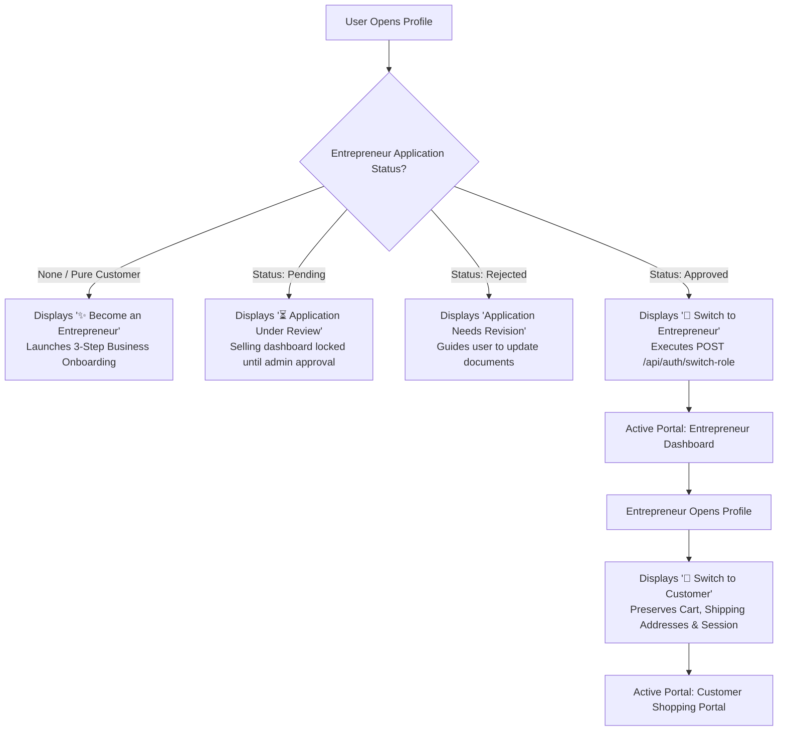

# Maneyindha Marukatte (ಮನೆಯಿಂದ ಮಾರುಕಟ್ಟೆ)
## Role-Based Application Architecture & Security Specifications

This document defines the complete role-based architecture, permissions, routing guards, authentication, and test credentials for the **Maneyindha Marukatte** full-stack e-commerce marketplace platform.

---

## 1. Three Distinct Application Portals

```
┌─────────────────────────────────────────────────────────────────────────────────────────┐
│                                  MANEYINDHA MARUKATTE                                   │
├──────────────────────────┬──────────────────────────────┬───────────────────────────────┤
│  1. CUSTOMER PORTAL      │   2. ENTREPRENEUR PORTAL     │   3. PRIVATE ADMIN PORTAL     │
│     (Public Marketplace) │      (Business Management)   │      (Platform Operations)    │
├──────────────────────────┼──────────────────────────────┼───────────────────────────────┤
│ • Product discovery      │ • Business Analytics         │ • Verification Queue (KYC)    │
│ • Cart & checkout        │ • Product & Stock Manager    │ • Product Moderation Queue    │
│ • Delivery tracking      │ • Order Fulfillment Pipeline │ • AI Trend & Category Scores  │
│ • Multilingual EN / KN   │ • Availability & Schedule    │ • Category Master Controls    │
│ • Customer Profile       │ • Entrepreneur Profile       │ • System Audit Logs           │
│ Screen: #screen-customer-*│ Screen: #screen-ent-*        │ Screen: #screen-admin-*       │
└──────────────────────────┴──────────────────────────────┴───────────────────────────────┘
```

### A. Customer Portal
- **Home & Browsing**: `#screen-customer-home`, `#screen-customer-category`
- **Product Details & Customization**: `#screen-customer-product-detail` with real-time stock and seller-configured dynamic customization options (e.g., spice levels, sugar preference, packaging type).
- **Cart & Order Isolation**: `#screen-customer-cart`. Validates that items belong strictly to a single entrepreneur per checkout, preventing fulfillment race conditions.
- **Order Tracking**: `#screen-customer-orders`, `#screen-customer-tracking` (Pending, Accepted, Preparing, Out for Delivery, Delivered).
- **Profile & Settings**: `#screen-customer-profile`, `#screen-customer-address-book`, `#screen-customer-notifications`, `#screen-customer-help-support`.

### B. Entrepreneur Portal
- **Business Dashboard**: `#screen-ent-dashboard` (Revenue cards, active orders, fulfillment shortcuts).
- **Inventory & Catalog Management**: `#screen-ent-inventory`, `#screen-ent-add-product`, `#screen-ent-edit-product`.
- **Order Management**: `#screen-ent-orders`, `#screen-ent-order-detail` with sequential status transitions and cancellation locks once orders reach "Preparing".
- **Business Schedule & Availability**: `#screen-ent-availability` (Toggle store open/closed, set opening hours).
- **Payouts & Payments**: `#screen-ent-payment-settings` (UPI ID, bank account, payout logs).
- **Reviews & Ratings**: `#screen-ent-reviews`.
- **Registration & Verification Pipeline**: 3-step registration wizard (`#screen-ent-reg-1`, `2`, `3`) with live KYC status checking (`#screen-ent-reg-status`).

### C. Critical Requirement: Private Admin Portal (Admin Only)
- **Zero Public Visibility**: Admin links, buttons, and navigation controls are completely stripped from public and customer interfaces.
- **Dedicated Login Screen**: `#screen-admin-login`.
- **Admin Control Center**: `#screen-admin-dashboard` featuring:
  - Entrepreneur KYC Verification Queue (Approve, Request Changes, Reject)
  - Product Moderation Queue (Flag, Approve, Remove)
  - Platform Analytics & AI Demand Trends
  - Category Master Controls (Activate / Deactivate categories)
  - System Security & Audit Logs
- **Client Route Interceptor**: Direct URL entries to `#screen-admin-*` require `apiClient.hasAdminAuth()` or valid session storage; unauthorized attempts redirect immediately to `#screen-admin-login`.
- **Server Route Interceptor**: Every `/api/admin/*` endpoint is guarded by `AuthMiddleware.requireAdmin`. Requests without a valid HMAC-SHA256 signature containing `role: 'admin'` receive `401 Unauthorized` or `403 Forbidden`.

---

## 2. Profile-Based Customer ↔ Entrepreneur Switching

The Profile tab dynamically adapts to the authenticated user's entrepreneur status without requiring repeated logins:



---

## 3. Authentication, Security & Test Credentials

### Cryptographic Security Specs:
- **Token Signing**: HMAC-SHA256 signature scheme with payload expiration (`exp`).
- **Password Hashing**: SHA-256 with per-application cryptographic salt (`maneyinda_salt_2026`).
- **Environment Isolation**: Configured via `.env` (template in `.env.example`). Secrets are never committed to public repositories.

### Verified Test Accounts & Credentials:

| Role / Account State | Email / Username | Password / OTP | Entrepreneur Profile | Capabilities |
| :--- | :--- | :--- | :--- | :--- |
| **Approved Entrepreneur & Customer** | `thanuja@example.com` | OTP: `123456` | `ent_01` (Approved) | Can shop as customer and switch seamlessly to Entrepreneur Dashboard |
| **Pure Customer** | `ravi@example.com` | OTP: `123456` | *None* | Shopping, Cart, Orders. Profile displays "✨ Become an Entrepreneur" |
| **Pending Applicant** | `savitha@tailors.com` | OTP: `123456` | `ent_04` (Pending) | Profile displays "⏳ Application Under Review"; selling tools locked |
| **Direct Entrepreneur Login** | `anitha@bakery.com` / `anitha_bakery` | `password123` | `ent_02` (Approved) | Direct login to Entrepreneur Dashboard (*Anitha Bakery*) |
| **Platform Administrator** | `admin@marukatte.internal` | `Admin@Marukatte2026!` | *N/A (Admin Role)* | Complete platform moderation, KYC approval, AI trend reports |

---

## 4. API Endpoints & Access Control Guards

| HTTP Method | Route | Authorization Middleware | Access Allowed |
| :--- | :--- | :--- | :--- |
| `GET` | `/api/health` | None | Public |
| `GET` | `/api/products` | None | Public |
| `POST` | `/api/auth/send-otp` | None | Public |
| `POST` | `/api/auth/verify-otp` | None | Public |
| `POST` | `/api/auth/login-customer` | None | Public |
| `POST` | `/api/auth/login-entrepreneur` | RateLimiter (5 attempts) | Registered Entrepreneurs |
| `POST` | `/api/auth/login-admin` | None | Authorized Administrators Only |
| `POST` | `/api/auth/switch-role` | `AuthMiddleware.authenticate` | Verified Customer / Approved Entrepreneur |
| `POST` | `/api/orders` | `AuthMiddleware.authenticate` | Customer |
| `PATCH` | `/api/orders/:id/status` | `AuthMiddleware.requireEntrepreneur` | Assigned Entrepreneur |
| `GET` | `/api/admin/verification-queue` | `AuthMiddleware.requireAdmin` | Platform Admin Only (401/403 guarded) |
| `POST` | `/api/admin/verify/:id` | `AuthMiddleware.requireAdmin` | Platform Admin Only |
| `GET` | `/api/admin/ai-trends` | `AuthMiddleware.requireAdmin` | Platform Admin Only |
| `POST` | `/api/admin/categories` | `AuthMiddleware.requireAdmin` | Platform Admin Only |

---

## 5. Automated Verification Results

All 20 integration tests executed against the REST server pass cleanly:

```text
✅ [PASS] GET /api/health should return status UP
✅ [PASS] GET /api/products should return product array
✅ [PASS] GET /api/products?category=Bakery%20%26%20Sweets should filter properly
✅ [PASS] POST /api/auth/send-otp should send OTP
✅ [PASS] POST /api/auth/verify-otp should accept demo OTP 123456
✅ [PASS] POST /api/auth/login-customer should sign in and return signed token
✅ [PASS] POST /api/auth/login-entrepreneur should authenticate valid entrepreneur
✅ [PASS] POST /api/orders should enforce single entrepreneur per order
✅ [PASS] POST /api/orders should REJECT multi-entrepreneur cart items
✅ [PASS] PATCH /api/orders/:id/status should update status to Accepted
✅ [PASS] POST /api/orders/:id/cancel should succeed on Accepted order
✅ [PASS] POST /api/orders advance to Preparing and verify cancellation blocks
✅ [PASS] POST /api/support/tickets should submit ticket
✅ [PASS] GET /api/admin/verification-queue without token MUST return 401 Unauthorized
✅ [PASS] GET /api/admin/verification-queue with Customer Token MUST return 403 Forbidden
✅ [PASS] POST /api/auth/login-admin with valid credentials grants Admin token
✅ [PASS] GET /api/admin/verification-queue with Admin Token returns 200 OK
✅ [PASS] GET /api/admin/ai-trends with Admin Token calculates scores
✅ [PASS] POST /api/auth/switch-role to entrepreneur BLOCKS unapproved customer
✅ [PASS] POST /api/auth/switch-role allows approved entrepreneur to switch to customer and back

TEST SUMMARY: 20 Passed, 0 Failed
```

---

## 6. How to Run & Verify

1. **Start Backend**:
   - Double-click `start-server.bat` (starts Node.js server on port 5000).
2. **Open Frontend**:
   - Double click `index.html` or open `file:///c:/Users/v_a_venkat/Documents/maneinda/index.html` in Chrome/Edge.
3. **Run Automated Test Suite**:
   ```bash
   "C:\Program Files\heroku\client\bin\node.exe" backend/test-api.js
   ```
